> one line about you, plain and specific.

what you're into, in two sentences. say what you're building right now and
what you're learning. skip the buzzwords.

`python` `javascript` `git` `linux` `(only what you actually use)`

[**project-name**](https://github.com/voidxiio/project-name) · `tech, tech`  
what it does in one sentence. what it's for.

[**project-name**](https://github.com/voidxiio/project-name) · `tech`  
what it does in one sentence.

[discord](#) · [instagram](#) · [email](mailto:you@example.com)
