<div align="center">



</div>

```bash
$ cat about.txt
```

```
name      : voidxiio
vibe      : chaotic but it compiles
stack     : whatever works today
mode      : side projects only
sleep     : optional
```

```bash
$ ls ~/projects
```

```
├── project-one/     # half finished, fully vibes
├── project-two/     # works on my machine
└── project-three/   # idea phase
```

```bash
$ ping me
```

[](https://github.com/voidxiio)

<sub>`exit 0`</sub>
